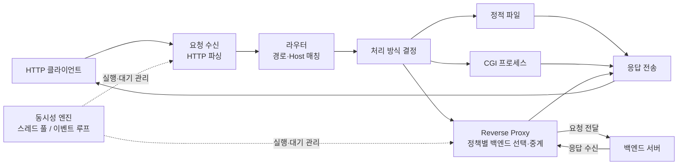
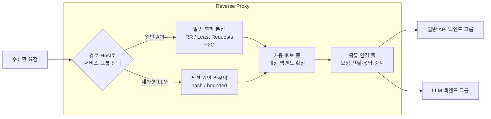

# httpd — C로 직접 만든 HTTP 서버와 프록시

> 일반 HTTP 요청과 LLM 스트리밍 요청을 하나의 서버에서 처리하고, 서비스 특성에 맞는 정책으로 백엔드를 선택하는 HTTP 서버·프록시입니다.

C11과 POSIX API로 요청 파싱부터 응답 전송, 연결 관리, 부하 분산을 직접 구현했습니다. **경로·Host로 서비스 그룹을 고르고, 일반 요청에는 부하 분산 정책을, 대화형 요청에는 세션과 부하를 고려한 정책을 적용**합니다. 각 정책은 연결 풀·장애 관리·응답 중계 경로를 공유합니다. 외부 HTTP·이벤트 루프 라이브러리 없이 동작하며, 실행 시 스레드 풀과 이벤트 루프를 선택할 수 있습니다.

프로젝트의 구조, 요청별 라우팅 정책과 성능 측정 결과를 정리했습니다. 기존 [과제 요구사항](docs/ASSIGNMENT.md)은 별도 문서로 보존합니다.

## 프로젝트 목표

처음 목표는 TCP 연결을 받아 정적 파일과 동적 응답을 제공하는 웹 서버를 만드는 것이었습니다. 구현을 진행하면서 다음 질문으로 범위를 넓혔습니다.

- 느린 클라이언트와 유휴 연결이 많아지면 동시성 모델에 따라 어떤 차이가 생길까?
- 백엔드의 처리 속도가 다르거나 장애가 나면 요청을 어떻게 분배해야 할까?
- LLM처럼 응답이 오래 이어지고 대화 캐시가 중요한 트래픽에서는 무엇을 기준으로 라우팅해야 할까?

기능을 추가한 뒤에는 테스트와 벤치마크로 동작과 선택의 근거를 남겼습니다.

## 구현한 기능

| 영역 | 주요 내용 |
| --- | --- |
| HTTP | GET·HEAD·POST, 요청 라인·헤더 파싱, Content-Length 본문 처리, Keep-Alive |
| 정적 파일 | MIME 매핑, 루트 밖 경로 접근 검사, 오류 응답, 조건부 요청에 대한 304 |
| CGI | fork·execve와 pipe로 프로그램 실행, 요청 본문 전달, 출력 파싱과 타임아웃 |
| Reverse Proxy | 경로·Host 라우팅, 요청·응답 헤더 변환, 응답 본문 스트리밍 |
| 부하 분산 | Round-Robin, Least Requests, P2C(Power of Two Choices) |
| 연결·장애 관리 | 업스트림 유휴 연결 풀, 실패 백엔드 제외, 시험 요청과 단계적 복귀 |
| 동시성 | 제한된 작업 큐를 사용하는 스레드 풀, epoll·kqueue·poll 기반 이벤트 루프 |
| Forward Proxy | `route … forward`로 활성화, absolute-form HTTP 요청의 목적지로 전달 |
| 포워드 응답 캐시 | GET 응답의 신선도·저장 조건 검사, LRU 삭제, `Age`·`X-Cache` 표시 |
| LLM 라우팅 실험 | 세션 키 해싱, 부하 상한을 둔 분산, 백엔드 대기열·KV 사용률 반영 후속 실험 |

포워드 프록시·캐시와 LLM 라우팅은 통합 코드에 반영된 확장 기능입니다. 관련 계약과 정책은 [결정 기록](docs/DECISIONS.md)의 D-045~047에서 **제안 상태**로 관리합니다. HTTP 전체 명세를 구현한 서버는 아니며, 지원 범위와 남은 과제는 아래에 정리했습니다.

## 요청은 어떻게 처리되는가



### 서비스와 상황에 따라 달라지는 라우팅

**Reverse Proxy가 요청에 맞는 백엔드를 선택하고 전달합니다.** 경로·Host로 서비스 그룹을 고른 뒤, 일반 HTTP 요청에는 부하 분산 정책을, 대화형 요청에는 세션 기반 정책을 적용합니다. 선택한 대상과의 연결 관리·응답 중계는 공통 경로에서 처리합니다.



**서비스 구분은 운영자가 설정한 경로·Host와 그룹 정책을 따릅니다.** 서버가 요청 본문을 읽고 일반 요청인지 LLM 요청인지 자동 분류하는 방식은 아닙니다. 다음은 한 프로세스에서 `/api/`와 `/llm/`을 각각 다른 백엔드 그룹으로 보내는 설정 예시입니다.

```text
listen 127.0.0.1:8080
root ./tests/fixtures/www
engine loop

upstream app 127.0.0.1:9001 127.0.0.1:9002
upstream llm 127.0.0.1:9101 127.0.0.1:9102
picker llm bounded 200

route /api/ proxy app strip
route /llm/ proxy llm strip
route / static ./tests/fixtures/www
```

이 설정을 사용하는 프로세스를 `HTTPD_PROXY_LB=least_requests`로 시작하면, `/api/`는 활성 요청이 적은 백엔드를 우선 선택합니다. `/llm/`의 첫 시도는 `X-Session-Id`가 있을 때 `bounded`로 선택합니다. 같은 세션의 캐시 지역성을 우선하되 해당 후보가 부하 상한에 도달하면 다음 후보를 살펴봅니다. `strip`은 백엔드에 보낼 때 서비스 경로 접두사를 제거합니다.

| 상황 | 선택 기준과 동작 | 설정 |
| --- | --- | --- |
| 처리 비용이 비슷한 일반 요청 | 백엔드를 순서대로 순환 | 일반 LB `rr` |
| 처리 속도가 다른 백엔드·느린 요청 혼재 | 활성 요청이 적은 후보를 우선 | 일반 LB `least_requests` |
| 두 후보의 현재 부하를 비교해 분산 | 무작위 후보 두 개 중 활성 요청이 적은 쪽 선택 | 일반 LB `p2c` |
| 같은 대화의 prefix 캐시를 유지하려는 요청 | 세션 키로 정한 가용 후보의 우선순위 사용 | 그룹별 `picker … hash` |
| 인기 대화가 몰리거나 백엔드 부하 차이가 큰 요청 | 세션 우선순위를 유지하되 부하 상한에 도달한 후보를 건너뜀 | 그룹별 `picker … bounded 200` |
| 세션 키가 없거나 해당 그룹이 기본 picker를 사용 | 일반 LB 정책으로 선택 | `X-Session-Id` 없음 / 기본 picker |
| 후보가 실패로 제외됐거나 복구 중 | 가용 상태와 복구 허용량을 반영해 후보 제한 | 공통 장애 관리 |

일반 LB는 시작 시 `HTTPD_PROXY_LB=rr|least_requests|p2c`로 지정하고, 세션 정책은 설정 파일의 `picker <그룹> hash|bounded`로 지정합니다. 현재 통합본의 `bounded`는 활성 요청 수를 부하 기준으로 사용합니다. 후속 실험 브랜치에서는 2초 이내의 백엔드 보고가 있으면 대기열과 KV 사용률도 반영합니다. 재시도는 기존 일반 정책과 재시도 가능 조건을 따릅니다.

**라우팅 정책과 동시성 엔진은 별도로 선택합니다.** `engine loop` 또는 `engine pool`은 프로세스 실행 방식이며, 요청마다 엔진을 바꾸지 않습니다. 어느 엔진에서도 공통 라우터·처리기·업스트림 경로를 사용합니다. 포워드 프록시는 `route … forward`로 활성화하고, 요청 URL의 목적지를 정한 뒤 같은 연결 관리와 중계 경로를 사용합니다.

### 응답을 결정하는 일과 전송하는 일을 분리

정적 파일·CGI·프록시 처리기는 클라이언트 소켓에 직접 쓰지 않습니다. 대신 메모리, 파일, pipe, 업스트림 중 **무엇을 보낼지 담은 응답 계획**(`response_plan_t`)을 반환합니다. 실제 전송과 자원 회수는 `downstream`이 맡습니다.

덕분에 처리기를 소켓 없이 검증하고, 같은 파서·라우터·처리기를 두 동시성 엔진에서 재사용할 수 있습니다.

### HTTP를 모르는 동시성 엔진

`engine`은 fd와 콜백만 관리합니다. HTTP 해석은 `downstream`, 백엔드 통신은 `upstream`에 둡니다.

| 스레드 풀 | 이벤트 루프 |
| --- | --- |
| 워커 하나가 연결 하나를 맡아 처리 | 준비된 fd의 이벤트마다 연결 상태를 진행 |
| 유휴 Keep-Alive도 워커를 점유 | 유휴 연결은 다음 이벤트를 기다림 |
| 작업 큐 포화 시 503 | 느린 송신 시 소스 읽기를 멈추는 backpressure 적용 |
| 워커 수·큐 크기가 중요한 조절값 | fd 감시·마감 관리·콜백 작업량이 중요 |

이벤트 루프는 마감을 최소 힙으로 관리하고, 해제된 등록 객체를 이벤트 배치가 끝날 때까지 보존합니다. 이는 같은 배치에 남은 이벤트와 재사용된 fd를 잘못 연결하지 않기 위한 설계입니다. 구조의 상세 설명은 [아키텍처 문서](docs/ARCHITECTURE.md)에 있습니다.

## 구현의 발전 과정

| 단계 | 구현·검증 내용 |
| --- | --- |
| 기반 구성 · Stage 1 | 문자열 뷰, 버퍼, 설정, 로그, 플랫폼 추상화와 공통 HTTP 규칙 |
| 요청 처리 · Stage 2 | 요청 파서, URI 정규화, 리스너와 연결 처리 |
| 웹 서버 · Stage 3 | 라우팅, 정적 파일, CGI, 응답 계획 |
| 프록시 · Stage 4 | 업스트림 중계, 부하 분산, 연결 재사용, 장애 복구와 성능 실험 |
| 동시 처리 검증 · Stage 5 | 스레드 풀 포화·종료·FD 한도 검증, 워커·큐 설정 비교 |
| 이벤트 처리 · Stage 7 | 이벤트 루프와 poller, 클라이언트·업스트림·CGI 상태 머신, 엔진 비교 |
| 통합·확장 | 포워드 프록시와 응답 캐시, 성질·공격 테스트, LLM 라우팅 실험 |

현재 [pending 목록](tests/pending.txt)에는 미통과 ID가 남아 있지 않고, 각 구현 디렉토리의 단계 체크가 완료되어 있습니다. 이는 현재 등록된 범위의 진행 상태이며, 기획서의 모든 추가 단위·비기능 테스트까지 완료했다는 뜻은 아닙니다.

## 성능을 어떻게 측정했고, 무엇을 확인했는가

성능 실험은 통합 프록시의 정책을 어떤 상황에 적용할지 판단하는 과정입니다. **백엔드 성능 차이 → 연결 재사용 → 동시 연결 → 스트리밍 → 세션 캐시 → 백엔드 보고 부하** 순서로 조건을 넓혀 측정했습니다.

| 실험 영역 | 확인하려던 질문 | 적용하는 설계·설정 |
| --- | --- | --- |
| 일반 HTTP 부하 분산·장애 | 백엔드 성능이 다르거나 일부가 느려지면 어떻게 분배할까? | RR·Least Requests·P2C, 연결 풀과 장애 복구 |
| 스레드 풀 용량 | 유휴 연결과 느린 수신이 워커를 점유하면 어떤 설정이 필요한가? | 워커 수·작업 큐 상한 |
| 이벤트 루프 | 유휴 연결이 많을 때 연결 대기 비용을 어떻게 줄일까? | fd 이벤트 기반 처리와 backpressure |
| SSE·장기 스트림 | 첫 토큰과 토큰 간격을 유지하며 여러 응답을 중계할 수 있는가? | 공통 스트리밍 중계·클라이언트 종료 전파 |
| 대화 캐시·쏠림 | 같은 대화의 캐시와 서버 간 분산을 함께 확보할 수 있는가? | 그룹별 hash·bounded picker |
| 백엔드 보고 부하 | 요청 수로 드러나지 않는 대기열·KV 비용을 반영할 수 있는가? | 후속 실험 브랜치의 bounded 부하 점수 확장 |

아래에는 통합 전 탐색 실험과 통합 후 후속 측정이 함께 있습니다. 각 표의 시점·조건·집계 기준을 표시했으며, 이전 구현에서 얻은 수치를 최신 통합본의 재측정 결과로 제시하지 않습니다. 로컬 E0·E1 기록에는 바이너리 해시가 없어 당시 실행 파일의 정확한 동일성을 확인할 수 없습니다.

### 측정 환경과 지표

일반 HTTP 실험은 macOS arm64 Mac16,1, 논리 CPU 10개, RAM 16 GiB, macOS 26.6.2·Apple Clang 21·Python 3.14.7 환경에서 수행했습니다. 클라이언트·프록시·백엔드를 같은 호스트의 루프백으로 연결했습니다. LLM 실험은 Apple M4 16 GB의 Ollama·llama3.2:1b 보정값을 사용하는 가짜 백엔드를 대상으로 합니다.

- **RPS**: Stage 4는 실패를 포함한 완료 시도 수, Stage 5·7은 HTTP 200 성공 응답 수를 기준으로 합니다.
- **P95·P99**: 요청 지연의 상위 백분위입니다. Stage 5·7은 성공한 작은 요청의 완료 지연입니다.
- **TTFT**: 요청 전송부터 첫 토큰 도착까지의 시간입니다. **ITL**은 토큰 사이 간격입니다.
- **FD·RSS**: 프록시 프로세스의 열린 파일 디스크립터와 메모리 표본입니다. 표본 최대가 순간 최대를 보장하지는 않습니다.

### 1. 백엔드 성능 차이와 장애 — 일반 HTTP 분산 정책과 연결 풀

**측정 과정.** 실험마다 프록시와 백엔드를 새로 시작했습니다. 워커 72개, 응답 1 KiB, 워밍업 48건을 고정하고, 18개 조건을 순서를 섞어 각 5회 실행했습니다. 아래 LB 표는 5회 평균입니다.

1. 풀 상한 8개·동시 클라이언트 24개에서 RR·Least Requests·P2C를 비교했습니다. 백엔드 지연은 동일 조건에서 모두 2 ms, 이기종 조건에서 1·4·14 ms이며, 조건별 480건을 보냈습니다.
2. 일부 장애는 시작 약 100 ms 뒤 B의 지연을 180 ms로 높이고 C의 연결·리스너를 닫았습니다. 전체 장애는 백엔드 세 대를 모두 닫았습니다. 약 300 ms 뒤 정상화하며, 360건을 4 ms 간격으로 제출했습니다.
3. 풀 상한 1·8·50개를 동시성 4·48에서 비교했습니다. 최초 집중 → 220 ms 유휴 뒤 재집중 → 원 서버가 연결을 끊은 뒤 재집중 순서로 각 240건씩 보냈습니다.
4. 별도로 실제 유휴 만료를 상한별 5회 관찰했습니다. 장애 실험의 응답 머리 마감 120 ms·Cooldown 700 ms는 실험용이며, 운영 기본 Cooldown 10초와 다릅니다.

| 지표 | RR | Least Requests | P2C |
| --- | ---: | ---: | ---: |
| 동일 백엔드 RPS | 6,153 | 6,429 | 6,324 |
| 이기종 백엔드 RPS | 2,764 | 4,949 | 4,452 |
| 이기종 평균 지연 | 8.08 ms | 4.32 ms | 4.83 ms |
| 일부 장애 P95 | 13.29 ms | 3.49 ms | 3.94 ms |
| 일부 장애 실패율 | 5.17% | 0.94% | 0.94% |
| 전체 장애 503 건수 평균 | 173.2 | 172.8 | 172.2 |

이기종 조건에서 Least Requests는 RR 대비 **RPS 79.0% 증가, 평균 지연 46.6% 감소**를 기록했습니다. 일부 장애에서 P95는 73.8% 감소하고 실패율은 4.22%p 낮아졌습니다. 다만 이기종 조건의 P99는 2.2% 늘었고, 전체 장애에서는 정책에 관계없이 약 49%가 실패했습니다. 모든 지연 지표가 함께 좋아진 결과는 아닙니다.

| 동시성 | 백엔드당 유휴 상한 | 신규 TCP 시도 평균 | 재사용률 | P95 |
| --- | ---: | ---: | ---: | ---: |
| 4 | 1 | 212.0 | 72.40% | 3.77 ms |
| 4 | 8 | 12.0 | 98.44% | 3.76 ms |
| 4 | 50 | 12.0 | 98.44% | 3.61 ms |
| 48 | 1 | 407.6 | 46.93% | 12.86 ms |
| 48 | 8 | 136.4 | 82.24% | 13.62 ms |
| 48 | 50 | 95.6 | 87.55% | 9.02 ms |

동시성 4에서 풀 8개는 1개 대비 신규 TCP 시도를 **94.3%** 줄였습니다. 동시성 48에서는 풀 50개가 8개보다 신규 TCP를 29.9%, P95를 33.8% 줄였으나, 더 큰 유휴 풀에는 연결 보유 비용이 따릅니다. 실제 유휴 시험에서는 약 62초 관측 때 연결이 남았고 약 92초에는 모두 정리됐습니다. 만료된 연결을 재획득하지 않는지는 별도 검증했습니다.

이 결과로 기본 유휴 상한은 8개를 유지하고, 이기종 백엔드용 `make reverse-proxy` 프로필에는 Least Requests를 적용했습니다.

```sh
make
python3 tests/bench/proxy_bench.py --out /tmp/proxy-measurements.jsonl
python3 tests/bench/proxy_idle_bench.py --out /tmp/proxy-idle.jsonl
python3 tests/bench/proxy_verify.py --idle-expiry
```

근거: [측정 과정과 해석](docs/benchmarks/README.md) · [전체 지표·표준편차](docs/benchmarks/proxy-tables.md) · [원본 JSONL](docs/benchmarks/proxy-macos.jsonl) · [유휴 만료 원본](docs/benchmarks/proxy-idle-macos.jsonl)

### 2. 유휴 연결과 느린 수신 — 스레드 풀의 워커·큐 설정

**측정 과정.** Least Requests·유휴 풀 8개·백엔드 지연 1·4·14 ms를 고정했습니다. 워커 20·40개와 큐 32·1,024칸의 네 조합에 일반 요청, 유휴 Keep-Alive 16개, 느린 대용량 수신을 적용했습니다. 12조건 × 5회이며, 매회 워밍업 48건 뒤 동시성 48로 작은 요청 480건을 보냈습니다. 느린 수신은 클라이언트 6개가 각각 8 MiB를 8 MiB/s로 받는 조건입니다.

| 부하 | 워커 / 큐 | 성공 RPS 평균 | 작은 요청 P99 평균 | 503 |
| --- | --- | ---: | ---: | ---: |
| 일반 | 20 / 32 | 4,835 | 22.72 ms | 0% |
| 일반 | 20 / 1,024 | 4,440 | 24.57 ms | 0% |
| 일반 | 40 / 32 | 5,090 | 27.35 ms | 0% |
| 일반 | 40 / 1,024 | 5,395 | 24.90 ms | 0% |
| 유휴 16개 | 20 / 32 | 779 | 57.57 ms | 84.46% |
| 유휴 16개 | 20 / 1,024 | 1,007 | 71.73 ms | 0% |
| 유휴 16개 | 40 / 32 | 5,183 | 23.80 ms | 0% |
| 유휴 16개 | 40 / 1,024 | 4,582 | 25.65 ms | 0% |
| 느린 수신 | 20 / 32 | 2,838 | 29.88 ms | 48.54% |
| 느린 수신 | 20 / 1,024 | 3,438 | 26.52 ms | 0% |
| 느린 수신 | 40 / 32 | 5,449 | 23.63 ms | 0% |
| 느린 수신 | 40 / 1,024 | 5,413 | 23.13 ms | 0% |

큐 1,024칸에서 워커를 20→40개로 늘리자 유휴 조건의 P99는 **71.73→25.65 ms**, RSS 표본 최대 평균은 **4.52→5.72 MiB**였습니다. 워커 증가의 처리 이득과 메모리 비용을 함께 확인하고, 후속 엔진 비교의 스레드 풀을 40개·1,024칸으로 정했습니다. P99는 성공 요청만 집계하므로 503 비율을 함께 봐야 합니다.

```sh
python3 tests/bench/worker_verify.py
python3 tests/bench/worker_bench.py --out /tmp/stage5-workers.jsonl
```

근거: [과부하·종료·FD 복구 검증과 표준편차](docs/benchmarks/stage5-workers.md) · [원본 JSONL](docs/benchmarks/stage5-workers-macos.jsonl)

### 3. 동시 연결 증가 — 스레드 풀과 이벤트 루프 비교

**측정 과정.** Stage 5에서 고른 스레드 풀과 이벤트 루프를 비교했습니다. LB·풀·백엔드 지연·동시성 48을 유지하고, 워밍업 48건 뒤 작은 요청 480건을 보냈습니다. 일반 요청, 유휴 연결 16개·36개, 느린 대용량 수신의 네 조건을 엔진별 5회씩 순서를 섞어 측정했습니다.

| 부하 | 엔진 | 성공 RPS (평균 ± 표본 표준편차) | 작은 요청 P99 (ms) | RSS 최대 표본 평균 |
| --- | --- | ---: | ---: | ---: |
| 일반 | 스레드 풀 | 5,361 ± 452 | 23.52 ± 0.59 | 6.04 MiB |
| 일반 | 이벤트 루프 | 5,593 ± 555 | 23.62 ± 1.85 | 4.64 MiB |
| 유휴 16개 | 스레드 풀 | 5,033 ± 198 | 22.65 ± 0.69 | 5.79 MiB |
| 유휴 16개 | 이벤트 루프 | 4,840 ± 280 | 25.16 ± 1.66 | 5.11 MiB |
| 유휴 36개 | 스레드 풀 | 1,057 ± 8 | 58.28 ± 1.34 | 5.92 MiB |
| 유휴 36개 | 이벤트 루프 | 4,115 ± 1,046 | 41.25 ± 24.05 | 5.60 MiB |
| 느린 수신 | 스레드 풀 | 5,643 ± 412 | 24.73 ± 2.57 | 6.06 MiB |
| 느린 수신 | 이벤트 루프 | 5,541 ± 223 | 26.05 ± 2.42 | 4.94 MiB |

유휴 연결 36개가 워커 40개 대부분을 점유하는 조건에서 이벤트 루프의 성공 RPS는 **3.89배**, P99 평균은 **29.22% 감소**했습니다. 다만 이벤트 루프 P99는 회차별 23.60~82.88 ms로 흔들렸고, 5회 중 1회는 스레드 풀보다 높았습니다. 일반 요청과 느린 수신의 처리량은 비슷했고, 모든 조건에서 두 엔진의 HTTP·수송 오류는 0건이었습니다.

```sh
python3 tests/bench/proxy_verify.py --engine loop
python3 tests/bench/worker_bench.py --compare-engines --out /tmp/stage7-engines.jsonl
```

근거: [엔진 비교 보고서](docs/benchmarks/stage7-engines.md) · [원본 JSONL](docs/benchmarks/stage7-engines-macos.jsonl). Linux에서는 epoll 기능과 sanitizer를 검증했고, 위 성능 수치는 macOS 측정입니다.

### 4. 오래 열린 응답 — SSE 중계 지연과 동시 스트림

**측정 과정.** Python 표준 라이브러리로 가짜 LLM·부하 생성기·실행기를 만들었습니다. E0에서는 백엔드 1대·동시성 1로 직접 연결과 프록시를 비교하고, 클라이언트 TTFT에서 백엔드 자체 TTFT를 뺀 값을 게이트웨이·네트워크 지연으로 봤습니다. 이어 토큰 전송 중과 prefill 중 클라이언트를 끊어 백엔드가 종료를 감지하기까지의 시간을 쟀습니다.

통합 전 탐색 측정인 11/24 E0의 시간 단위는 ms입니다. TTFT·ITL·추가 지연은 중앙값이며 경로별 정상 요청 20건입니다. 추가 지연에는 직접 연결의 클라이언트·네트워크 비용도 들어가므로, 프록시 자체 비용만의 값으로 보지는 않습니다.

| 경로 | TTFT | 추가 지연 | ITL | 전송 중 종료 감지 중앙 / 최대 | prefill 중 종료 감지 중앙 / 최대 |
| --- | ---: | ---: | ---: | ---: | ---: |
| 직접 연결 | 65.0 | 1.64 | 18.2 | 0.5 / 0.6 | 0.6 / 0.7 |
| 이벤트 루프 | 65.1 | 1.99 | 18.2 | 34.4 / 102.3 | 2,440.9 / 2,455.0 |
| 스레드 풀 | 65.6 | 2.29 | 18.2 | 34.6 / 100.5 | 2,442.3 / 2,458.9 |

전송 중 종료 10건·prefill 중 종료 3건은 각 경로에서 모두 감지됐습니다. 정상 중계의 TTFT와 ITL은 비슷했지만, 당시 프록시 경로에서는 첫 토큰 전에 취소한 요청의 종료 감지가 늦었습니다.

**오래 열린 스트림 E1.** 백엔드 4대의 슬롯·KV 상한을 크게 하고 배치당 추가 비용을 0으로 두어 백엔드 병목을 줄였습니다. 약 30초짜리 1,500토큰 스트림을 동시성 4→64로 늘리고, 워커 8개의 스레드 풀과 이벤트 루프를 비교했습니다. 각 조건은 1회 탐색 측정입니다.

| 동시 스트림 | 이벤트 루프 성공 / 시도 | 루프 TTFT 중앙값 | 스레드 풀 성공 / 시도 | 풀 TTFT 중앙값 |
| --- | ---: | ---: | ---: | ---: |
| 4 | 4 / 4 | 43 ms | 4 / 4 | 43 ms |
| 8 | 8 / 8 | 64 ms | 8 / 8 | 63 ms |
| 16 | 16 / 16 | 105 ms | 8 / 16 | 65 ms |
| 32 | 32 / 32 | 207 ms | 8 / 32 | 66 ms |
| 64 | 64 / 64 | 372 ms | 8 / 64 | 69 ms |

동시성 64에서 루프는 64건 모두 성공했고, 풀은 8건만 성공했습니다. 나머지는 원본에 `ConnectionResetError`로 기록됐습니다. 풀의 낮은 TTFT는 **성공한 8건만** 반영합니다. 이 결과는 해당 워커 수와 당시 실행 조건의 관측이며, 스레드 풀 전체의 최대 처리 능력으로 일반화하지 않습니다.

```sh
# macOS에서는 절전을 막고 실행
caffeinate -i python3 -I bench/run_bench.py e0 --engines loop pool
caffeinate -i python3 -I bench/run_bench.py e1 --engines loop pool --workers 8
```

근거: [E0·E1 도구와 시간 측정 방식](bench/README.md), 로컬 `20261124-144854-e0`·`20261124-145052-e1` 결과. 요약과 실패 집계는 [측정 근거 스냅샷](docs/benchmarks/llm-local-evidence.json)에 보존했습니다.

### 5. 대화형 트래픽 — 처리 능력·캐시 지역성·부하 분산

**보정 과정.** 실제 Ollama·llama3.2:1b를 입력 길이·동시성·캐시 적중 조건별로 측정해 fake LLM의 계수를 정했습니다. 입력 3,464토큰의 첫 prefill은 3,667 ms였고, 반복 적중 후에는 17 ms까지 줄었습니다. 병렬 4에서 동시성 4→8로 늘릴 때 처리량은 약 103 tok/s에 머물고 TTFT 중앙값은 372→2,793 ms로 늘었습니다. 이 패턴을 슬롯·대기열·prefix 캐시 모델에 반영했습니다.

**처리 능력 탐색.** 백엔드 4대·이벤트 루프에서 속도별 40초, 워밍업 10초를 제외하고 1회씩 측정했습니다. 도착이 끝난 뒤 진행 중 요청의 완료까지 기다렸습니다. A는 입력 500·출력 100토큰, B는 짧은 요청 90%에 입력 5,000·출력 500토큰의 긴 요청 10%를 섞습니다.

| 시나리오 | 도착률 | 완료율 | 짧은 요청 TTFT 중앙값 / P99 |
| --- | ---: | ---: | ---: |
| A | 2.0 req/s | 1.96 req/s | 491 / 2,556 ms |
| A | 3.0 req/s | 2.66 req/s | 2,554 / 5,309 ms |
| A | 4.0 req/s | 2.60 req/s | 9,640 / 12,803 ms |
| B | 1.5 req/s | 1.00 req/s | 481 / 1,642 ms |
| B | 2.0 req/s | 1.39 req/s | 503 / 8,658 ms |
| B | 2.5 req/s | 1.29 req/s | 2,666 / 27,400 ms |

같은 백엔드라도 긴 요청이 섞이면 짧은 요청의 꼬리 지연이 더 낮은 도착률부터 커졌습니다. 모든 요청이 200으로 끝나도 대기 시간이 늘 수 있어, 성공률과 RPS만으로 상태를 판단하기 어렵습니다. 이 값은 가짜 백엔드의 처리 능력이며 실제 GPU 서버의 성능 수치가 아닙니다.

**A·B 반복 측정(E2).** 처리 능력 탐색 뒤에는 도착률을 달리해 각 120초·워밍업 10초·시드 1~3으로 3회 측정했습니다. 아래는 짧은 요청에 대한 실행별 지표의 중앙값이며, 단위는 ms입니다. 측정 요청의 HTTP·수송 오류는 이 여섯 조건 모두 0건이었습니다.

| 시나리오 / 도착률 | TTFT P50 | TTFT P99 | 백엔드 대기열 P99 | 게이트웨이·네트워크 P99 |
| --- | ---: | ---: | ---: | ---: |
| A / 1.3 req/s | 470.9 | 506.9 | 21.3 | 3.9 |
| A / 2.1 req/s | 488.6 | 856.4 | 367.0 | 3.7 |
| A / 3.9 req/s | 20,339.8 | 36,053.5 | 35,562.9 | 4.2 |
| B / 0.7 req/s | 470.9 | 1,122.8 | 643.2 | 5.2 |
| B / 1.1 req/s | 479.8 | 3,185.8 | 2,484.3 | 4.2 |
| B / 2.1 req/s | 10,479.7 | 29,106.9 | 28,617.0 | 4.1 |

과부하에서 TTFT가 수십 초까지 커지는 동안 게이트웨이·네트워크 P99는 약 4~5 ms였습니다. 이 실험에서는 백엔드 대기열이 지연의 주된 원인으로 관측됐습니다. 각 열의 백분위는 서로 다른 요청에서 나올 수 있으므로 합산하지 않습니다.

**세션 라우팅 비교.** 시나리오 C는 대화가 진행되며 입력 prefix가 쌓입니다. 백엔드 4대, 대화 8개, 도착률 0.3 req/s, 240초 중 워밍업 60초 제외, 시드 1~3으로 정책마다 3회 측정했습니다. 균등 분포와 인기 대화에 요청이 몰리는 Zipf 1.0을 비교했습니다. 아래 값은 실행별 지표의 중앙값이며, TTFT는 초입니다. 캐시 적중률은 토큰 기준, 넘침은 키의 1순위 백엔드가 아닌 곳으로 간 비율입니다.

| 분포 | picker | TTFT P50 | TTFT P99 | 캐시 적중률 | 넘침 |
| --- | --- | ---: | ---: | ---: | ---: |
| 균등 | RR | 3.8 s | 11.7 s | 31% | 80% |
| 균등 | hash | 1.8 s | 10.4 s | 62% | 0% |
| 균등 | bounded 125 | 3.8 s | 15.1 s | 48% | 29% |
| 균등 | bounded 150 | 1.8 s | 14.6 s | 53% | 21% |
| 균등 | bounded 200 | 1.8 s | 12.9 s | 54% | 15% |
| Zipf 1.0 | RR | 3.8 s | 12.2 s | 27% | 75% |
| Zipf 1.0 | hash | 3.8 s | 29.1 s | 58% | 0% |
| Zipf 1.0 | bounded 125 | 3.8 s | 13.8 s | 36% | 39% |
| Zipf 1.0 | bounded 150 | 3.8 s | 15.3 s | 39% | 31% |
| Zipf 1.0 | bounded 200 | 3.2 s | 19.5 s | 45% | 19% |

hash는 균등 분포에서 캐시를 잘 살렸지만, Zipf 분포에서는 쏠림으로 P99가 RR의 약 2.4배가 됐습니다. bounded는 캐시 지역성과 부하 분산 사이의 절충을 보여 줬습니다. 상한 200은 균등 분포에서 hash와 비슷한 P50을 유지하면서 상한 125보다 넘침이 적었습니다. 다만 실행당 측정 요청이 52~59건이라 P99가 최댓값에 가까우며, RR보다 P99가 개선됐다고 결론 내리지는 않았습니다.

C의 처리 능력 탐색은 속도별 150초·워밍업 60초·1회씩 수행했습니다. 도착률 1.2 req/s에서 RR·hash·bounded 125의 완료율은 각각 **0.31·0.39·0.44 req/s**였습니다. 단일 회차의 과부하 탐색값이며 3회 반복한 위 표와는 별도 실험입니다.

```sh
caffeinate -i python3 -I bench/run_bench.py capacity --name A --rates 1 2 3 4 5
caffeinate -i python3 -I bench/run_bench.py scenario --name B --rate 1.1 --duration 120 --warmup 10 --repeat 3
caffeinate -i python3 -I bench/run_bench.py scenario --name C --picker bounded:200 --conversations 8 --rate 0.3 --duration 240 --warmup 60 --repeat 3
# Zipf 분포는 같은 명령에 --zipf 1.0 추가
```

근거: [Ollama 보정](bench/calib/results-2026-11-24-m4-llama3.2-1b/SUMMARY.md) · [D-045](docs/DECISIONS.md#d-045-ai-라우팅-그룹별-picker와-고정-키-해싱) · [측정 근거 스냅샷](docs/benchmarks/llm-local-evidence.json). D-045의 위 결과는 세션 정책을 통합하기 전 탐색 구현에서 측정한 값입니다.

### 6. 통합 후 후속 측정 — 종료 전파와 백엔드 보고 부하

**11/25 E0.** 같은 방식으로 직접 연결과 통합 후 이벤트 루프 경로를 측정한 로컬 결과가 있습니다. 정상 요청은 경로별 25건, 종료 전파는 전송 중 10건·prefill 중 3건입니다. 시간은 ms이며 지연은 중앙값입니다.

| 경로 | TTFT | 게이트웨이·네트워크 지연 | ITL | 전송 중 종료 감지 중앙 / 최대 | prefill 중 종료 감지 중앙 / 최대 |
| --- | ---: | ---: | ---: | ---: | ---: |
| 직접 연결 | 64.5 | 1.26 | 18.1 | 0.5 / 0.6 | 0.5 / 0.7 |
| 이벤트 루프 | 65.1 | 1.90 | 18.2 | 0.6 / 1.0 | 1.0 / 1.3 |

이 측정에서는 취소한 요청이 모두 감지됐고, prefill 중 취소도 최대 1.3 ms에 감지됐습니다. 11/24 결과와 차이가 있지만 두 기록에는 바이너리 해시가 없고 표본 수도 달라, 이를 특정 수정 하나의 개선율로 계산하지 않습니다.

**후속 실험 브랜치의 base/kv 비교.** `feat/upstream-reported-load`에서 기존 bounded가 보는 활성 요청 수에 백엔드 보고 대기열과 KV 사용률을 더했습니다. 이 확장은 이 문서 PR 기준 `develop`에는 포함되지 않았습니다. Zipf 1.0·대화 8개·0.3 req/s·240초·워밍업 60초·3회 조건의 로컬 base/kv 결과를 집계했습니다. 실행별 지표의 중앙값입니다.

| 지표 | 기존 bounded 200 (base) | 보고 부하 반영 (kv) |
| --- | ---: | ---: |
| TTFT P50 | 3.224 s | 3.049 s |
| TTFT P99 | 19.469 s | 17.975 s |
| 토큰 캐시 적중률 | 44.6% | 44.6% |
| 1순위 밖 배정 | 18.6% | 16.9% |

이 표에서는 TTFT P99가 약 7.7% 낮았지만, 3회·소표본이며 같은 해시 기반 후보 선택을 공유하는 조건의 탐색 결과입니다. 균등 분포 base의 3회와 kv의 첫 회는 측정 요청이 1건뿐이라 비교에서 제외했습니다. 원인은 이 문서 작업에서 확정하지 않았고, 균등 분포까지 개선된다고 주장하지 않습니다.

```sh
# 별도 실험 브랜치에서 두 빌드를 준비한다. BASE_HTTPD는 기존 빌드의 절대 경로.
python3 -I bench/run_bench.py --httpd "$BASE_HTTPD" scenario --name C --picker bounded:200 --zipf 1.0 --conversations 8 --rate 0.3 --duration 240 --warmup 60 --repeat 3 --tag=-base
python3 -I bench/run_bench.py scenario --name C --picker bounded:200 --zipf 1.0 --conversations 8 --rate 0.3 --duration 240 --warmup 60 --repeat 3 --tag=-kv
```

근거: 별도 실험 브랜치 `feat/upstream-reported-load`의 로컬 `20261125-103238-e0`·`20261125-123036-C-loop-bounded-base-z1.0-r0.3`·`20261125-124327-C-loop-bounded-kv-z1.0-r0.3`. 실행별 집계와 원본 파일 해시는 [측정 근거 스냅샷](docs/benchmarks/llm-local-evidence.json)에 보존했습니다. 로컬 `bench/results/`는 gitignore 대상이므로 스냅샷은 원본 전체를 대신하지 않습니다.

### 측정 결과를 통합 구조에 적용하기

백엔드 처리 속도가 다른 일반 서비스에는 Least Requests를 적용하고, 대화 캐시가 중요한 그룹에는 hash 또는 bounded를 설정할 수 있습니다. 긴 스트림과 유휴 연결이 많은 환경에서는 이벤트 루프를 선택할 근거가 있으며, 연결 풀은 공통 중계 경로에서 TCP 연결 생성 비용을 줄입니다. 정책별 이점을 한 서버에서 조합할 수 있도록 구성했습니다.

핵심은 서비스 경로와 그룹 설정으로 처리 정책을 나누고, 실행 중에는 가용 상태·활성 요청·세션 키에 따라 백엔드를 선택하는 것입니다. 최신 부하 보고의 반영은 후속 실험으로 평가합니다. 각 실험은 한 호스트의 제한된 부하에서 수행됐으며, 전체 표가 최신 통합본에서 다시 측정된 것은 아닙니다.

## 발표 데모

저장소 루트에서 `python3 demo/run.py`를 실행하고 [스터디룸](http://127.0.0.1:8080/)을 엽니다. 학생별 학습 채팅으로 요청을 보내면 C 서버의 실제 배정, 동시 요청, 장애 복구를 확인할 수 있습니다. 실행 옵션과 시연 순서는 [데모 안내](demo/README.md)에 있습니다.

## 실행하기

저장소 루트에서 실행합니다. C11 컴파일러, Make, POSIX 환경이 필요하며 테스트에는 Python 3를 사용합니다. 서버 링크 의존성은 pthread입니다.

### 정적 파일·CGI 데모

```sh
make

cat > /tmp/httpd-demo.conf <<'EOF'
listen 127.0.0.1:8080
root ./tests/fixtures/www
route / static ./tests/fixtures/www
route /cgi-bin/ cgi ./tests/fixtures/cgi-bin
EOF

./build/httpd -c /tmp/httpd-demo.conf -e loop
```

다른 터미널에서 요청합니다. `-e pool`로 바꾸면 같은 설정을 스레드 풀로 실행합니다.

```sh
curl -i http://127.0.0.1:8080/
curl -i -d 'hello=httpd' http://127.0.0.1:8080/cgi-bin/echo.py
```

### 리버스 프록시 데모

정적 파일 데모 서버를 종료한 뒤, 아래 백엔드를 각각 별도 터미널에서 실행합니다.

```sh
python3 -m http.server 8081 --bind 127.0.0.1 --directory tests/fixtures/www
```

```sh
python3 -m http.server 8082 --bind 127.0.0.1 --directory tests/fixtures/www
```

```sh
python3 -m http.server 8083 --bind 127.0.0.1 --directory tests/fixtures/www
```

프록시 터미널에서 실행한 뒤 다른 터미널에서 `curl -i http://127.0.0.1:8080/`로 확인합니다.

```sh
make reverse-proxy ENGINE=loop
```

기본 설정은 `127.0.0.1:8080`에서 받아 `8081~8083`으로 전달합니다. `ENGINE=pool`로 엔진을 바꿀 수 있습니다. 설정 상세는 [실행 프로필](conf/reverse-proxy.conf)과 [프록시 운영 문서](docs/PROXY_STAGE4.md)를 참고합니다. 최신 포워드 설정 문법은 [config.h](src/core/config.h), 정책은 D-046·047을 따릅니다.

## 검증 방식

정상 응답뿐 아니라 잘못된 입력, 중간 연결 종료, 자원 회수까지 검증합니다.

| 검증 층 | 확인하는 내용 |
| --- | --- |
| 계약 테스트 | 공개 함수의 반환값, 경계값, 소유권 |
| E2E | 실제 서버·소켓을 통한 정적 파일, CGI, 프록시, 캐시, Keep-Alive, 오류 처리 |
| 성질 검사 | 입력 분할에 따른 파서 결과 일관성, 버퍼 범위, 경로 정규화, 청크 본문 경계 |
| 공격·경계 E2E | 요청 밀반입, 경로 탈출, half-close, 잘못된 백엔드 응답, 동시 연결과 자원 회수 |
| 부하 실험 | 처리량, 지연 백분위, 실패율, 연결 재사용률, FD·RSS, LLM TTFT |

```sh
make lint
make test
make test ENGINE=loop

# Linux에서 sanitizer 검증
make asan
make asan ENGINE=loop
make robust
```

CI는 Linux·macOS의 빌드·린트·기본 테스트·이벤트 루프 E2E를 실행하고, Linux에서 ASan·UBSan과 보조 스위트를 실행하도록 구성되어 있습니다. 보조 스위트가 통합본에서 발견한 요청 대상 제어 문자 처리, 문자열 뷰 수명, 업스트림 본문 뒤 잔여 바이트 처리 문제와 수정 근거는 [검증 기록](tests/robust/README.md)에 남겼습니다.

테스트 범위와 러너 사용법은 [테스트 문서](docs/TESTING.md)를 따릅니다. 위 명령은 재현 절차이며, 성능 수치는 기존 측정 기록을 사용했습니다. 문서 변경에 대한 검사 결과는 PR에 기록합니다.

## 현재 한계와 다음 과제

- 요청 본문은 Content-Length 기반입니다. chunked 요청 본문과 HTTPS CONNECT는 지원 범위 밖입니다.
- 포워드 프록시는 IPv6 리터럴을 지원하지 않으며, 처음 보는 목적지의 이름 해석이 이벤트 루프를 잠시 막을 수 있습니다.
- 이벤트 루프의 네트워크·pipe 대기는 비동기로 처리하지만, 로컬 파일 I/O·로그·CGI 생성과 회수는 기존 시스템 호출을 사용합니다.
- 모든 백엔드가 불가할 때 요청을 잠시 보관하는 복구 FIFO는 D-042의 후속 과제입니다.
- 포워드 캐시는 저장 조건이 맞는 GET·200·Content-Length 응답에 한정합니다. 일반적인 HTTP 캐시 전체를 구현하지 않습니다.
- LLM picker의 통합본 전체 재측정, 표본이 부족했던 균등 분포 base/kv 재실험, 백엔드 보고 부하의 효과 검증이 남아 있습니다.

## 문서 안내

- [아키텍처](docs/ARCHITECTURE.md): 모듈 경계, 응답 계획, 요청 흐름, 두 엔진의 구조
- [구현·운영 기록](docs/PROXY_STAGE4.md): 프록시 연결 관리, 장애 정책, 실행 설정
- [성능 측정](docs/benchmarks/README.md): 원본 데이터와 재현 방법
- [LLM 실험 도구](bench/README.md): 스트리밍 부하·세션 라우팅 비교
- [결정 기록](docs/DECISIONS.md): 확정 사항과 검토 중인 제안
- [전역 규약](docs/CONVENTIONS.md): 소유권, include 방향, 인터페이스·협업 규칙
