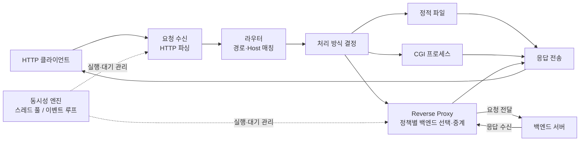
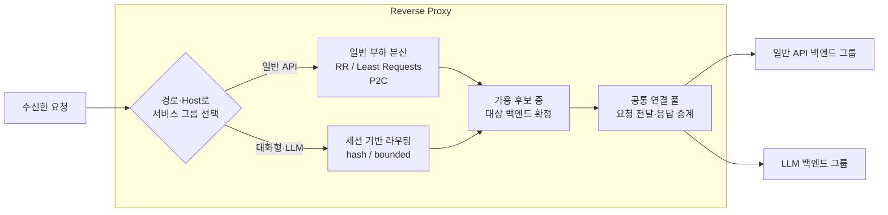

# httpd — C로 직접 만든 HTTP 서버와 프록시

> 일반 HTTP 요청과 LLM 스트리밍 요청을 하나의 서버에서 처리하고, 서비스 특성에 맞는 정책으로 백엔드를 선택하는 HTTP 서버·프록시입니다.

C11·POSIX API로 파싱, 전송, 연결 관리와 부하 분산을 구현했습니다. **경로·Host로 서비스 그룹을 고르고, 일반 요청은 부하 중심으로, 대화형 요청은 세션·부하를 함께 고려해 분산**합니다. 연결 풀·장애 관리·중계 경로를 공유하며 스레드 풀과 이벤트 루프를 지원합니다. 외부 HTTP·이벤트 루프 라이브러리는 사용하지 않습니다.

구조·라우팅 정책·성능 측정 결과를 정리했습니다. 기존 [과제 요구사항](docs/ASSIGNMENT.md)은 별도 보존합니다.

## 프로젝트 목표

정적·동적 응답을 제공하는 웹 서버에서 출발해, 동시성·장애 대응·LLM 라우팅으로 확장했습니다.

- 유휴 연결과 느린 클라이언트에 적합한 동시성 모델은 무엇인가?
- 백엔드 성능 차이와 장애에 어떻게 대응할 것인가?
- 긴 스트림과 대화 캐시를 고려해 어떻게 분산할 것인가?

각 선택의 근거는 테스트와 벤치마크로 검증했습니다.

## 구현한 기능

| 영역 | 주요 내용 |
| --- | --- |
| HTTP | GET·HEAD·POST, 요청 라인·헤더 파싱, Content-Length 본문 처리, Keep-Alive |
| 정적 파일 | MIME 매핑, 루트 밖 경로 접근 검사, 오류 응답, 조건부 요청에 대한 304 |
| CGI | fork·execve와 pipe로 프로그램 실행, 요청 본문 전달, 출력 파싱과 타임아웃 |
| Reverse Proxy | 경로·Host 라우팅, 요청·응답 헤더 변환, 응답 본문 스트리밍 |
| 부하 분산 | Round-Robin, Least Requests, P2C(Power of Two Choices) |
| 연결·장애 관리 | 업스트림 유휴 연결 풀, 실패 백엔드 제외, 시험 요청과 단계적 복귀 |
| 동시성 | 제한된 작업 큐를 사용하는 스레드 풀, epoll·kqueue·poll 기반 이벤트 루프 |
| Forward Proxy | `route … forward`로 활성화, absolute-form HTTP 요청의 목적지로 전달 |
| 포워드 응답 캐시 | GET 응답의 신선도·저장 조건 검사, LRU 삭제, `Age`·`X-Cache` 표시 |
| LLM 라우팅 실험 | 세션 키 해싱, 부하 상한을 둔 분산, 백엔드 대기열·KV 사용률 반영 후속 실험 |

포워드 프록시·캐시·세션 라우팅은 통합된 확장 기능입니다. 정책은 [D-045~047](docs/DECISIONS.md)에서 제안 상태로 관리하며, 지원 한계는 아래에 정리했습니다.

## 요청은 어떻게 처리되는가



### 서비스와 상황에 따라 달라지는 라우팅

**경로·Host로 서비스 그룹을 고른 뒤, 일반 요청은 부하 분산 정책으로, 대화형 요청은 세션 정책으로 백엔드를 선택합니다.** 연결 관리와 응답 중계는 공통 경로를 사용합니다.



**서비스 구분은 설정된 경로·Host와 그룹 정책을 따릅니다.** 다음은 `/api/`와 `/llm/`을 다른 그룹으로 보내는 예시입니다.

```text
listen 127.0.0.1:8080
root ./tests/fixtures/www
engine loop

upstream app 127.0.0.1:9001 127.0.0.1:9002
upstream llm 127.0.0.1:9101 127.0.0.1:9102
picker llm bounded 200

route /api/ proxy app strip
route /llm/ proxy llm strip
route / static ./tests/fixtures/www
```

`HTTPD_PROXY_LB=least_requests`로 시작하면 `/api/`는 활성 요청이 적은 대상을 고릅니다. `/llm/`은 첫 시도에 `X-Session-Id`가 있으면 bounded를 사용해 세션 우선순위와 부하 상한을 반영합니다. `strip`은 서비스 경로 접두사를 제거합니다.

| 상황 | 선택 기준과 동작 | 설정 |
| --- | --- | --- |
| 처리 비용이 비슷한 일반 요청 | 백엔드를 순서대로 순환 | 일반 LB `rr` |
| 처리 속도가 다른 백엔드·느린 요청 혼재 | 활성 요청이 적은 후보를 우선 | 일반 LB `least_requests` |
| 두 후보의 현재 부하를 비교해 분산 | 무작위 후보 두 개 중 활성 요청이 적은 쪽 선택 | 일반 LB `p2c` |
| 같은 대화의 prefix 캐시를 유지하려는 요청 | 세션 키로 정한 가용 후보의 우선순위 사용 | 그룹별 `picker … hash` |
| 인기 대화가 몰리거나 백엔드 부하 차이가 큰 요청 | 세션 우선순위를 유지하되 부하 상한에 도달한 후보를 건너뜀 | 그룹별 `picker … bounded 200` |
| 세션 키가 없거나 해당 그룹이 기본 picker를 사용 | 일반 LB 정책으로 선택 | `X-Session-Id` 없음 / 기본 picker |
| 후보가 실패로 제외됐거나 복구 중 | 가용 상태와 복구 허용량을 반영해 후보 제한 | 공통 장애 관리 |

일반 LB는 `HTTPD_PROXY_LB=rr|least_requests|p2c`, 세션 정책은 `picker <그룹> hash|bounded`로 지정합니다. 통합본의 bounded는 활성 요청 수를 사용하며, 후속 실험은 2초 이내의 대기열·KV 보고도 반영합니다. 재시도에는 기존 일반 정책과 허용 조건을 적용합니다.

**엔진은 프로세스 시작 시 `loop` 또는 `pool`로 선택하며 라우팅 정책과 독립적입니다.** 포워드 프록시는 `route … forward`로 켜고, URL의 목적지로 공통 연결·중계 경로를 사용합니다.

### 응답을 결정하는 일과 전송하는 일을 분리

처리기는 **무엇을 보낼지 담은 응답 계획**(`response_plan_t`)을 반환하고, `downstream`이 전송과 자원 회수를 맡습니다.

처리기를 소켓 없이 검증하고 두 엔진에서 같은 파서·라우터·처리기를 재사용합니다.

### HTTP를 모르는 동시성 엔진

`engine`은 fd·콜백, `downstream`은 HTTP, `upstream`은 백엔드 통신을 담당합니다.

| 스레드 풀 | 이벤트 루프 |
| --- | --- |
| 워커 하나가 연결 하나를 맡아 처리 | 준비된 fd의 이벤트마다 연결 상태를 진행 |
| 유휴 Keep-Alive도 워커를 점유 | 유휴 연결은 다음 이벤트를 기다림 |
| 작업 큐 포화 시 503 | 느린 송신 시 소스 읽기를 멈추는 backpressure 적용 |
| 워커 수·큐 크기가 중요한 조절값 | fd 감시·마감 관리·콜백 작업량이 중요 |

이벤트 루프는 최소 힙으로 마감을 관리하고, 등록 객체를 이벤트 배치 종료까지 보존해 이전 이벤트와 재사용된 fd를 구분합니다. [아키텍처 상세](docs/ARCHITECTURE.md)

## 구현의 발전 과정

| 단계 | 구현·검증 내용 |
| --- | --- |
| 기반 구성 · Stage 1 | 문자열 뷰, 버퍼, 설정, 로그, 플랫폼 추상화와 공통 HTTP 규칙 |
| 요청 처리 · Stage 2 | 요청 파서, URI 정규화, 리스너와 연결 처리 |
| 웹 서버 · Stage 3 | 라우팅, 정적 파일, CGI, 응답 계획 |
| 프록시 · Stage 4 | 업스트림 중계, 부하 분산, 연결 재사용, 장애 복구와 성능 실험 |
| 동시 처리 검증 · Stage 5 | 스레드 풀 포화·종료·FD 한도 검증, 워커·큐 설정 비교 |
| 이벤트 처리 · Stage 7 | 이벤트 루프와 poller, 클라이언트·업스트림·CGI 상태 머신, 엔진 비교 |
| 통합·확장 | 포워드 프록시와 응답 캐시, 성질·공격 테스트, LLM 라우팅 실험 |

[pending 목록](tests/pending.txt)은 비어 있으며 구현 단계 체크도 완료됐습니다. 현재 등록된 테스트 범위의 상태이며, 추가 단위·비기능 테스트는 후속 과제입니다.

## 성능을 어떻게 측정했고, 무엇을 확인했는가

**부하 분산 → 연결 재사용 → 동시 연결 → 스트리밍 → 세션 캐시 → 백엔드 보고 부하** 순서로 적용 조건을 검증했습니다.

| 실험 영역 | 확인하려던 질문 | 적용하는 설계·설정 |
| --- | --- | --- |
| 일반 HTTP 부하 분산·장애 | 백엔드 성능이 다르거나 일부가 느려지면 어떻게 분배할까? | RR·Least Requests·P2C, 연결 풀과 장애 복구 |
| 스레드 풀 용량 | 유휴 연결과 느린 수신이 워커를 점유하면 어떤 설정이 필요한가? | 워커 수·작업 큐 상한 |
| 이벤트 루프 | 유휴 연결이 많을 때 연결 대기 비용을 어떻게 줄일까? | fd 이벤트 기반 처리와 backpressure |
| SSE·장기 스트림 | 첫 토큰과 토큰 간격을 유지하며 여러 응답을 중계할 수 있는가? | 공통 스트리밍 중계·클라이언트 종료 전파 |
| 대화 캐시·쏠림 | 같은 대화의 캐시와 서버 간 분산을 함께 확보할 수 있는가? | 그룹별 hash·bounded picker |
| 백엔드 보고 부하 | 요청 수로 드러나지 않는 대기열·KV 비용을 반영할 수 있는가? | 후속 실험 브랜치의 bounded 부하 점수 확장 |

통합 전·후 결과는 표별 시점과 조건으로 구분했습니다. 전체 표가 최신 통합본의 재측정 결과는 아니며, 로컬 E0·E1은 바이너리 해시가 없어 실행 파일의 동일성을 확인할 수 없습니다.

### 측정 환경과 지표

일반 HTTP는 macOS arm64 Mac16,1·논리 CPU 10개·RAM 16 GiB·macOS 26.6.2·Clang 21·Python 3.14.7의 루프백 환경에서 측정했습니다. LLM은 M4 16 GB의 Ollama·llama3.2:1b 보정값을 쓰는 가짜 백엔드입니다.

- **RPS**: Stage 4는 실패를 포함한 완료 시도 수, Stage 5·7은 HTTP 200 성공 응답 수를 기준으로 합니다.
- **P95·P99**: 요청 지연의 상위 백분위입니다. Stage 5·7은 성공한 작은 요청의 완료 지연입니다.
- **TTFT**: 요청 전송부터 첫 토큰 도착까지의 시간입니다. **ITL**은 토큰 사이 간격입니다.
- **FD·RSS**: 열린 파일 디스크립터·메모리 표본. 표본 최대는 순간 최대와 다를 수 있습니다.

### 1. 백엔드 성능 차이와 장애 — 일반 HTTP 분산 정책과 연결 풀

**측정:** 매회 프록시·백엔드를 재시작하고 워커 72개·응답 1 KiB·워밍업 48건을 고정했습니다. 18조건을 순서를 섞어 5회씩 실행했으며 표는 평균입니다.

1. **LB:** 풀 8개·동시성 24·480건. 백엔드 지연은 동일 2 ms, 이기종 1·4·14 ms로 비교했습니다.
2. **장애:** 시작 약 100 ms 뒤 B를 180 ms로 지연하고 C를 종료하거나, 전체 백엔드를 종료했습니다. 약 300 ms 뒤 복구하며 360건을 4 ms 간격으로 보냈습니다.
3. **풀:** 상한 1·8·50개, 동시성 4·48. 최초 집중 → 220 ms 유휴 뒤 재집중 → 원 서버 연결 종료 뒤 재집중으로 각 240건을 보냈습니다.
4. **만료:** 상한별 5회 관찰했습니다. 장애 실험은 머리 마감 120 ms·Cooldown 700 ms이며 운영 기본 Cooldown은 10초입니다.

| 지표 | RR | Least Requests | P2C |
| --- | ---: | ---: | ---: |
| 동일 백엔드 RPS | 6,153 | 6,429 | 6,324 |
| 이기종 백엔드 RPS | 2,764 | 4,949 | 4,452 |
| 이기종 평균 지연 | 8.08 ms | 4.32 ms | 4.83 ms |
| 일부 장애 P95 | 13.29 ms | 3.49 ms | 3.94 ms |
| 일부 장애 실패율 | 5.17% | 0.94% | 0.94% |
| 전체 장애 503 건수 평균 | 173.2 | 172.8 | 172.2 |

**Least Requests:** 이기종 RPS +79.0%·평균 지연 −46.6%, 일부 장애 P95 −73.8%·실패율 −4.22%p. 이기종 P99는 2.2% 늘었으며, 전체 장애 실패율은 정책별 약 49%였습니다.

| 동시성 | 백엔드당 유휴 상한 | 신규 TCP 시도 평균 | 재사용률 | P95 |
| --- | ---: | ---: | ---: | ---: |
| 4 | 1 | 212.0 | 72.40% | 3.77 ms |
| 4 | 8 | 12.0 | 98.44% | 3.76 ms |
| 4 | 50 | 12.0 | 98.44% | 3.61 ms |
| 48 | 1 | 407.6 | 46.93% | 12.86 ms |
| 48 | 8 | 136.4 | 82.24% | 13.62 ms |
| 48 | 50 | 95.6 | 87.55% | 9.02 ms |

**풀 효과:** 동시성 4에서 상한 8은 1 대비 신규 TCP −94.3%. 동시성 48에서 상한 50은 8 대비 TCP −29.9%·P95 −33.8%였습니다. 유휴 연결은 약 62초에 남아 있었고 92초에 정리됐으며, 만료 후 재획득 방지도 별도 확인했습니다.

유휴 연결 보유 비용을 고려해 기본 상한은 8개, 이기종 실행 프로필은 Least Requests를 사용합니다.

```sh
make
python3 tests/bench/proxy_bench.py --out /tmp/proxy-measurements.jsonl
python3 tests/bench/proxy_idle_bench.py --out /tmp/proxy-idle.jsonl
python3 tests/bench/proxy_verify.py --idle-expiry
```

근거: [측정 과정과 해석](docs/benchmarks/README.md) · [전체 지표·표준편차](docs/benchmarks/proxy-tables.md) · [원본 JSONL](docs/benchmarks/proxy-macos.jsonl) · [유휴 만료 원본](docs/benchmarks/proxy-idle-macos.jsonl)

### 2. 유휴 연결과 느린 수신 — 스레드 풀의 워커·큐 설정

**측정:** Least Requests·풀 8개·지연 1·4·14 ms에서 워커 20·40 × 큐 32·1,024 × 부하 3종을 각 5회 비교했습니다. 워밍업 48건 뒤 동시성 48로 480건을 전송했습니다. 추가 부하는 유휴 연결 16개 또는 8 MiB를 8 MiB/s로 받는 클라이언트 6개입니다.

| 부하 | 워커 / 큐 | 성공 RPS 평균 | 작은 요청 P99 평균 | 503 |
| --- | --- | ---: | ---: | ---: |
| 일반 | 20 / 32 | 4,835 | 22.72 ms | 0% |
| 일반 | 20 / 1,024 | 4,440 | 24.57 ms | 0% |
| 일반 | 40 / 32 | 5,090 | 27.35 ms | 0% |
| 일반 | 40 / 1,024 | 5,395 | 24.90 ms | 0% |
| 유휴 16개 | 20 / 32 | 779 | 57.57 ms | 84.46% |
| 유휴 16개 | 20 / 1,024 | 1,007 | 71.73 ms | 0% |
| 유휴 16개 | 40 / 32 | 5,183 | 23.80 ms | 0% |
| 유휴 16개 | 40 / 1,024 | 4,582 | 25.65 ms | 0% |
| 느린 수신 | 20 / 32 | 2,838 | 29.88 ms | 48.54% |
| 느린 수신 | 20 / 1,024 | 3,438 | 26.52 ms | 0% |
| 느린 수신 | 40 / 32 | 5,449 | 23.63 ms | 0% |
| 느린 수신 | 40 / 1,024 | 5,413 | 23.13 ms | 0% |

**워커 20→40개:** 큐 1,024의 유휴 조건에서 P99 71.73→25.65 ms, RSS 4.52→5.72 MiB였습니다. 후속 엔진 비교는 워커 40·큐 1,024를 사용합니다. P99는 성공 요청만 집계하므로 503 비율과 함께 봐야 합니다.

```sh
python3 tests/bench/worker_verify.py
python3 tests/bench/worker_bench.py --out /tmp/stage5-workers.jsonl
```

근거: [과부하·종료·FD 복구 검증과 표준편차](docs/benchmarks/stage5-workers.md) · [원본 JSONL](docs/benchmarks/stage5-workers-macos.jsonl)

### 3. 동시 연결 증가 — 스레드 풀과 이벤트 루프 비교

**측정:** 같은 바이너리에서 엔진만 바꿨습니다. Stage 5의 LB·풀·지연·동시성 48을 유지하고, 워밍업 48건 뒤 480건을 보냈습니다. 일반·유휴 16개·유휴 36개·느린 수신의 4조건을 엔진별 5회씩 섞어 실행했습니다.

| 부하 | 엔진 | 성공 RPS (평균 ± 표본 표준편차) | 작은 요청 P99 (ms) | RSS 최대 표본 평균 |
| --- | --- | ---: | ---: | ---: |
| 일반 | 스레드 풀 | 5,361 ± 452 | 23.52 ± 0.59 | 6.04 MiB |
| 일반 | 이벤트 루프 | 5,593 ± 555 | 23.62 ± 1.85 | 4.64 MiB |
| 유휴 16개 | 스레드 풀 | 5,033 ± 198 | 22.65 ± 0.69 | 5.79 MiB |
| 유휴 16개 | 이벤트 루프 | 4,840 ± 280 | 25.16 ± 1.66 | 5.11 MiB |
| 유휴 36개 | 스레드 풀 | 1,057 ± 8 | 58.28 ± 1.34 | 5.92 MiB |
| 유휴 36개 | 이벤트 루프 | 4,115 ± 1,046 | 41.25 ± 24.05 | 5.60 MiB |
| 느린 수신 | 스레드 풀 | 5,643 ± 412 | 24.73 ± 2.57 | 6.06 MiB |
| 느린 수신 | 이벤트 루프 | 5,541 ± 223 | 26.05 ± 2.42 | 4.94 MiB |

**유휴 36개:** 이벤트 루프의 RPS는 3.89배, P99 평균은 29.22% 감소했습니다. 단, P99는 23.60~82.88 ms로 흔들렸고 1회는 풀보다 높았습니다. 일반·느린 수신 처리량은 비슷했으며 두 엔진의 HTTP·수송 오류는 모두 0건입니다.

```sh
python3 tests/bench/proxy_verify.py --engine loop
python3 tests/bench/worker_bench.py --compare-engines --out /tmp/stage7-engines.jsonl
```

근거: [엔진 비교 보고서](docs/benchmarks/stage7-engines.md) · [원본 JSONL](docs/benchmarks/stage7-engines-macos.jsonl). Linux에서는 epoll 기능과 sanitizer를 검증했고, 위 성능 수치는 macOS 측정입니다.

### 4. 오래 열린 응답 — SSE 중계 지연과 동시 스트림

**E0 측정:** 가짜 LLM 1대·동시성 1로 직접 연결과 프록시를 비교했습니다. 추가 지연은 클라이언트 TTFT−백엔드 TTFT이며, 전송 중·prefill 중 취소의 백엔드 감지 시간도 측정했습니다.

**11/24 통합 전 탐색:** 정상 요청 경로별 20건, 단위 ms. TTFT·ITL·추가 지연은 중앙값이며, 추가 지연에는 클라이언트·네트워크 비용도 포함됩니다.

| 경로 | TTFT | 추가 지연 | ITL | 전송 중 종료 감지 중앙 / 최대 | prefill 중 종료 감지 중앙 / 최대 |
| --- | ---: | ---: | ---: | ---: | ---: |
| 직접 연결 | 65.0 | 1.64 | 18.2 | 0.5 / 0.6 | 0.6 / 0.7 |
| 이벤트 루프 | 65.1 | 1.99 | 18.2 | 34.4 / 102.3 | 2,440.9 / 2,455.0 |
| 스레드 풀 | 65.6 | 2.29 | 18.2 | 34.6 / 100.5 | 2,442.3 / 2,458.9 |

전송 중 10건·prefill 중 3건의 종료를 모두 감지했습니다. 정상 TTFT·ITL은 비슷했지만, 당시 프록시는 첫 토큰 전 취소 감지가 늦었습니다.

**E1 측정:** 슬롯·KV 상한을 늘리고 배치 추가 비용을 없앤 백엔드 4대에서, 약 30초·1,500토큰 스트림을 동시성 4→64로 늘렸습니다. 워커 8의 풀과 루프를 조건별 1회 비교했습니다.

| 동시 스트림 | 이벤트 루프 성공 / 시도 | 루프 TTFT 중앙값 | 스레드 풀 성공 / 시도 | 풀 TTFT 중앙값 |
| --- | ---: | ---: | ---: | ---: |
| 4 | 4 / 4 | 43 ms | 4 / 4 | 43 ms |
| 8 | 8 / 8 | 64 ms | 8 / 8 | 63 ms |
| 16 | 16 / 16 | 105 ms | 8 / 16 | 65 ms |
| 32 | 32 / 32 | 207 ms | 8 / 32 | 66 ms |
| 64 | 64 / 64 | 372 ms | 8 / 64 | 69 ms |

**동시성 64:** 루프 64건·풀 8건 성공, 풀의 나머지는 `ConnectionResetError`였습니다. 풀 TTFT는 성공 8건만 반영하며, 이 1회 측정을 전체 처리 한도로 일반화하지 않습니다.

```sh
# macOS에서는 절전을 막고 실행
caffeinate -i python3 -I bench/run_bench.py e0 --engines loop pool
caffeinate -i python3 -I bench/run_bench.py e1 --engines loop pool --workers 8
```

근거: [E0·E1 도구와 시간 측정 방식](bench/README.md), 로컬 `20261124-144854-e0`·`20261124-145052-e1` 결과. 요약과 실패 집계는 [측정 근거 스냅샷](docs/benchmarks/llm-local-evidence.json)에 보존했습니다.

### 5. 대화형 트래픽 — 처리 능력·캐시 지역성·부하 분산

**보정:** Ollama·llama3.2:1b의 입력 길이·동시성·캐시를 측정했습니다. 3,464토큰 prefill은 캐시 적중 후 3,667→17 ms로 줄었습니다. 병렬 4에서 동시성 4→8은 처리량 약 103 tok/s를 유지하며 TTFT가 372→2,793 ms로 늘었습니다. 이를 가짜 백엔드의 슬롯·대기열·캐시에 반영했습니다.

**처리 능력:** 백엔드 4대·루프에서 속도별 40초·워밍업 10초 제외·1회 측정하고 잔여 요청 완료까지 기다렸습니다. A는 입력/출력 500/100토큰, B는 A 90%와 긴 요청 5,000/500토큰 10%입니다.

| 시나리오 | 도착률 | 완료율 | 짧은 요청 TTFT 중앙값 / P99 |
| --- | ---: | ---: | ---: |
| A | 2.0 req/s | 1.96 req/s | 491 / 2,556 ms |
| A | 3.0 req/s | 2.66 req/s | 2,554 / 5,309 ms |
| A | 4.0 req/s | 2.60 req/s | 9,640 / 12,803 ms |
| B | 1.5 req/s | 1.00 req/s | 481 / 1,642 ms |
| B | 2.0 req/s | 1.39 req/s | 503 / 8,658 ms |
| B | 2.5 req/s | 1.29 req/s | 2,666 / 27,400 ms |

긴 요청이 섞이면 더 낮은 도착률부터 짧은 요청의 꼬리 지연이 커졌습니다. 모두 200이어도 대기는 늘 수 있으며, 이 값은 가짜 백엔드의 성능입니다.

**E2 측정:** 도착률별 120초·워밍업 10초·시드 1~3으로 3회 실행했습니다. 표는 짧은 요청의 실행별 지표 중앙값(ms)이며 HTTP·수송 오류는 모두 0건입니다.

| 시나리오 / 도착률 | TTFT P50 | TTFT P99 | 백엔드 대기열 P99 | 게이트웨이·네트워크 P99 |
| --- | ---: | ---: | ---: | ---: |
| A / 1.3 req/s | 470.9 | 506.9 | 21.3 | 3.9 |
| A / 2.1 req/s | 488.6 | 856.4 | 367.0 | 3.7 |
| A / 3.9 req/s | 20,339.8 | 36,053.5 | 35,562.9 | 4.2 |
| B / 0.7 req/s | 470.9 | 1,122.8 | 643.2 | 5.2 |
| B / 1.1 req/s | 479.8 | 3,185.8 | 2,484.3 | 4.2 |
| B / 2.1 req/s | 10,479.7 | 29,106.9 | 28,617.0 | 4.1 |

**과부하 병목은 백엔드 대기열**로 관측됐습니다. TTFT는 수십 초까지 늘었지만 게이트웨이·네트워크 P99는 약 4~5 ms였습니다. 열별 백분위는 합산하지 않습니다.

**세션 비교:** prefix가 쌓이는 C 시나리오에서 백엔드 4대·대화 8개·0.3 req/s·240초·워밍업 60초 제외·3회를 적용했습니다. 균등·Zipf 1.0을 비교하며, 표는 실행별 지표 중앙값입니다. 적중률은 토큰 기준, 넘침은 키의 1순위 밖 배정 비율입니다.

| 분포 | picker | TTFT P50 | TTFT P99 | 캐시 적중률 | 넘침 |
| --- | --- | ---: | ---: | ---: | ---: |
| 균등 | RR | 3.8 s | 11.7 s | 31% | 80% |
| 균등 | hash | 1.8 s | 10.4 s | 62% | 0% |
| 균등 | bounded 125 | 3.8 s | 15.1 s | 48% | 29% |
| 균등 | bounded 150 | 1.8 s | 14.6 s | 53% | 21% |
| 균등 | bounded 200 | 1.8 s | 12.9 s | 54% | 15% |
| Zipf 1.0 | RR | 3.8 s | 12.2 s | 27% | 75% |
| Zipf 1.0 | hash | 3.8 s | 29.1 s | 58% | 0% |
| Zipf 1.0 | bounded 125 | 3.8 s | 13.8 s | 36% | 39% |
| Zipf 1.0 | bounded 150 | 3.8 s | 15.3 s | 39% | 31% |
| Zipf 1.0 | bounded 200 | 3.2 s | 19.5 s | 45% | 19% |

**hash는 캐시 적중을 높였지만 Zipf P99는 RR의 약 2.4배**였습니다. bounded 200은 균등 분포에서 hash와 비슷한 P50을 유지하고 125보다 넘침이 적었습니다. 실행당 52~59건으로 P99 편차가 커, RR 대비 개선으로 단정하지 않습니다.

별도 C 탐색(속도별 150초·워밍업 60초·1회)에서 도착률 1.2 req/s의 RR·hash·bounded 125 완료율은 **0.31·0.39·0.44 req/s**였습니다.

```sh
caffeinate -i python3 -I bench/run_bench.py capacity --name A --rates 1 2 3 4 5
caffeinate -i python3 -I bench/run_bench.py scenario --name B --rate 1.1 --duration 120 --warmup 10 --repeat 3
caffeinate -i python3 -I bench/run_bench.py scenario --name C --picker bounded:200 --conversations 8 --rate 0.3 --duration 240 --warmup 60 --repeat 3
# Zipf 분포는 같은 명령에 --zipf 1.0 추가
```

근거: [Ollama 보정](bench/calib/results-2026-11-24-m4-llama3.2-1b/SUMMARY.md) · [D-045](docs/DECISIONS.md#d-045-ai-라우팅-그룹별-picker와-고정-키-해싱) · [측정 근거 스냅샷](docs/benchmarks/llm-local-evidence.json). D-045의 위 결과는 세션 정책을 통합하기 전 탐색 구현에서 측정한 값입니다.

### 6. 통합 후 후속 측정 — 종료 전파와 백엔드 보고 부하

**11/25 통합 후 E0:** 경로별 정상 25건, 전송 중 취소 10건·prefill 중 3건을 측정했습니다. 시간은 ms, 지연은 중앙값입니다.

| 경로 | TTFT | 게이트웨이·네트워크 지연 | ITL | 전송 중 종료 감지 중앙 / 최대 | prefill 중 종료 감지 중앙 / 최대 |
| --- | ---: | ---: | ---: | ---: | ---: |
| 직접 연결 | 64.5 | 1.26 | 18.1 | 0.5 / 0.6 | 0.5 / 0.7 |
| 이벤트 루프 | 65.1 | 1.90 | 18.2 | 0.6 / 1.0 | 1.0 / 1.3 |

취소를 모두 감지했고 prefill 중 감지는 최대 1.3 ms였습니다. 11/24와 표본 수가 다르고 빌드 해시가 없어 특정 수정의 개선율로 환산하지 않습니다.

**후속 base/kv 비교:** `feat/upstream-reported-load`에서 대기열·KV 보고를 추가했습니다(이 PR 기준 develop 미포함). Zipf 1.0·대화 8개·0.3 req/s·240초·워밍업 60초·3회의 실행별 중앙값입니다.

| 지표 | 기존 bounded 200 (base) | 보고 부하 반영 (kv) |
| --- | ---: | ---: |
| TTFT P50 | 3.224 s | 3.049 s |
| TTFT P99 | 19.469 s | 17.975 s |
| 토큰 캐시 적중률 | 44.6% | 44.6% |
| 1순위 밖 배정 | 18.6% | 16.9% |

**TTFT P99 약 7.7% 감소**는 3회·소표본의 탐색 결과입니다. 균등 분포 base 3회와 kv 첫 회는 측정 요청이 1건뿐이라 제외했으며, 원인은 미확정입니다.

```sh
# 별도 실험 브랜치에서 두 빌드를 준비한다. BASE_HTTPD는 기존 빌드의 절대 경로.
python3 -I bench/run_bench.py --httpd "$BASE_HTTPD" scenario --name C --picker bounded:200 --zipf 1.0 --conversations 8 --rate 0.3 --duration 240 --warmup 60 --repeat 3 --tag=-base
python3 -I bench/run_bench.py scenario --name C --picker bounded:200 --zipf 1.0 --conversations 8 --rate 0.3 --duration 240 --warmup 60 --repeat 3 --tag=-kv
```

근거: [측정 스냅샷](docs/benchmarks/llm-local-evidence.json)의 11/25 E0·Zipf base/kv 결과. 실행별 집계·원본 해시를 보존했으며, gitignore 대상인 로컬 `bench/results/` 원본 전체를 대신하지는 않습니다.

### 측정 결과를 통합 구조에 적용하기

**백엔드 성능이 다른 일반 서비스는 Least Requests, 대화 캐시는 hash·bounded, 긴 스트림·유휴 연결은 이벤트 루프**를 선택할 근거를 얻었습니다. 연결 풀과 중계 경로는 함께 재사용합니다.

경로·그룹 설정으로 정책을 나누고, 가용 상태·활성 요청·세션 키로 대상을 고릅니다. 부하 보고는 후속 실험이며, 한 호스트의 결과를 최신 통합본 전체 성능으로 일반화하지 않습니다.

## 발표 데모

`python3 demo/run.py`로 실행한 뒤 [스터디룸](http://127.0.0.1:8080/)에서 실제 배정·동시 요청·장애 복구를 확인합니다. [데모 안내](demo/README.md)

## 실행하기

C11 컴파일러·Make·POSIX 환경과 pthread가 필요합니다. 테스트는 Python 3를 사용하며 아래 명령은 저장소 루트에서 실행합니다.

### 정적 파일·CGI 데모

```sh
make

cat > /tmp/httpd-demo.conf <<'EOF'
listen 127.0.0.1:8080
root ./tests/fixtures/www
route / static ./tests/fixtures/www
route /cgi-bin/ cgi ./tests/fixtures/cgi-bin
EOF

./build/httpd -c /tmp/httpd-demo.conf -e loop
```

다른 터미널에서 요청합니다. `-e pool`로 바꾸면 같은 설정을 스레드 풀로 실행합니다.

```sh
curl -i http://127.0.0.1:8080/
curl -i -d 'hello=httpd' http://127.0.0.1:8080/cgi-bin/echo.py
```

### 리버스 프록시 데모

정적 파일 데모 서버를 종료한 뒤, 아래 백엔드를 각각 별도 터미널에서 실행합니다.

```sh
python3 -m http.server 8081 --bind 127.0.0.1 --directory tests/fixtures/www
```

```sh
python3 -m http.server 8082 --bind 127.0.0.1 --directory tests/fixtures/www
```

```sh
python3 -m http.server 8083 --bind 127.0.0.1 --directory tests/fixtures/www
```

프록시를 실행한 뒤 다른 터미널에서 `curl -i http://127.0.0.1:8080/`로 확인합니다.

```sh
make reverse-proxy ENGINE=loop
```

`8080`에서 받아 `8081~8083`으로 전달하며 `ENGINE=pool`로 엔진을 바꿉니다. [실행 설정](conf/reverse-proxy.conf) · [운영 문서](docs/PROXY_STAGE4.md) · [설정 문법](src/core/config.h), D-046·047

## 검증 방식

정상 응답뿐 아니라 잘못된 입력, 중간 연결 종료, 자원 회수까지 검증합니다.

| 검증 층 | 확인하는 내용 |
| --- | --- |
| 계약 테스트 | 공개 함수의 반환값, 경계값, 소유권 |
| E2E | 실제 서버·소켓을 통한 정적 파일, CGI, 프록시, 캐시, Keep-Alive, 오류 처리 |
| 성질 검사 | 입력 분할에 따른 파서 결과 일관성, 버퍼 범위, 경로 정규화, 청크 본문 경계 |
| 공격·경계 E2E | 요청 밀반입, 경로 탈출, half-close, 잘못된 백엔드 응답, 동시 연결과 자원 회수 |
| 부하 실험 | 처리량, 지연 백분위, 실패율, 연결 재사용률, FD·RSS, LLM TTFT |

```sh
make lint
make test
make test ENGINE=loop

# Linux에서 sanitizer 검증
make asan
make asan ENGINE=loop
make robust
```

CI는 Linux·macOS의 빌드·린트·두 엔진 테스트와 Linux의 ASan·UBSan·보조 스위트를 실행합니다. 발견한 버그와 수정 근거는 [검증 기록](tests/robust/README.md)에 있습니다.

[테스트 범위·러너 사용법](docs/TESTING.md)을 따릅니다. 성능 수치는 기존 기록이며 문서 검사 결과는 PR에 기록합니다.

## 현재 한계와 다음 과제

- Content-Length 요청 본문을 지원하며 chunked 요청·HTTPS CONNECT는 미지원입니다.
- 포워드 IPv6 리터럴은 미지원이며, 첫 목적지 DNS 조회는 루프를 잠시 막을 수 있습니다.
- 네트워크·pipe 대기는 비동기지만 파일·로그 I/O와 CGI 생성·회수는 로컬 시스템 호출입니다.
- 전체 백엔드 불가 시의 복구 FIFO는 D-042 후속 과제입니다.
- 포워드 캐시는 저장 조건을 만족하는 GET·200·Content-Length 응답에 한정됩니다.
- LLM 정책의 통합본 재측정, 균등 분포 base/kv 재실험과 부하 보고 효과 검증이 남아 있습니다.

## 문서 안내

- [아키텍처](docs/ARCHITECTURE.md): 모듈 경계, 응답 계획, 요청 흐름, 두 엔진의 구조
- [구현·운영 기록](docs/PROXY_STAGE4.md): 프록시 연결 관리, 장애 정책, 실행 설정
- [성능 측정](docs/benchmarks/README.md): 원본 데이터와 재현 방법
- [LLM 실험 도구](bench/README.md): 스트리밍 부하·세션 라우팅 비교
- [결정 기록](docs/DECISIONS.md): 확정 사항과 검토 중인 제안
- [전역 규약](docs/CONVENTIONS.md): 소유권, include 방향, 인터페이스·협업 규칙
